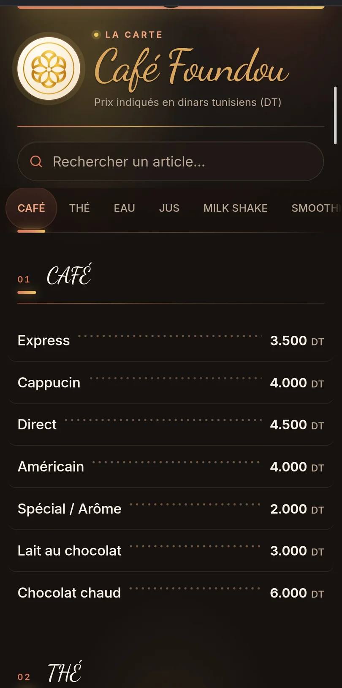
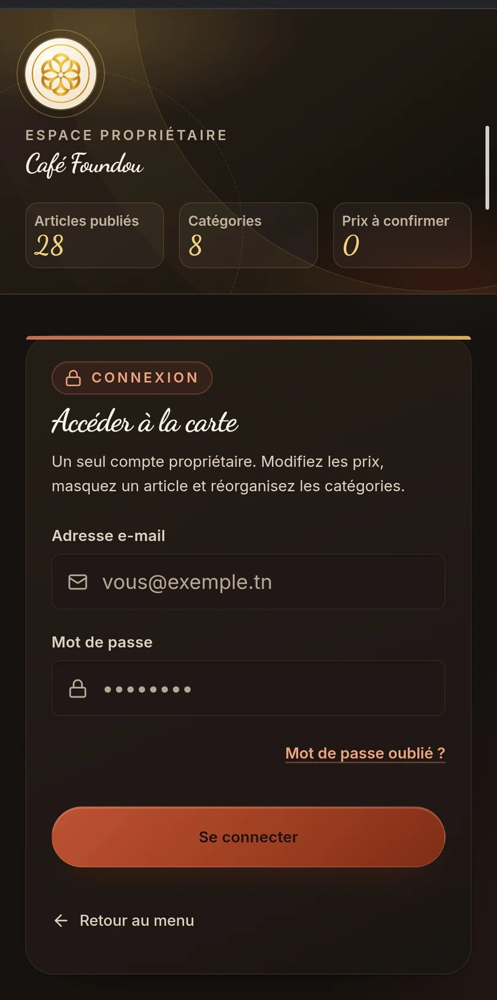
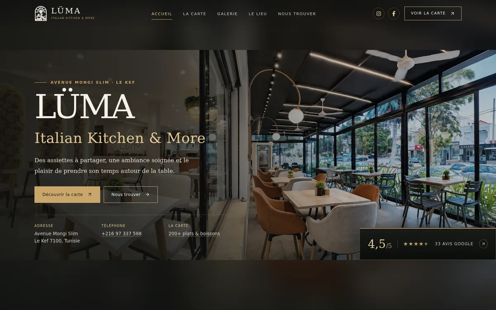
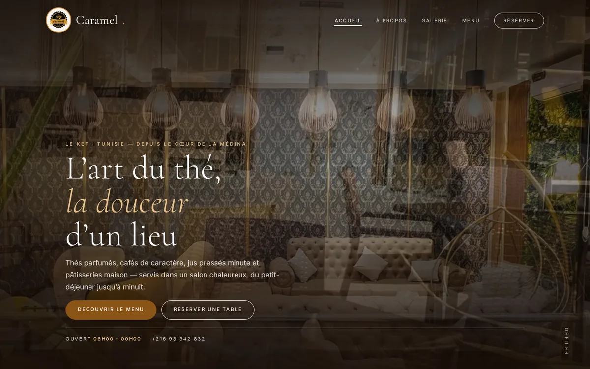

# Stoufa

**Full-stack developer & student · Tunisia**

I build web products for local businesses — fast, accessible sites for their customers,
and the private tools their owners need to keep them current.

---

I work mostly on small, real products rather than demos: restaurant and café sites,
a QR menu with an owner dashboard, and a community platform with Discord auth. I care
about the unglamorous parts — accurate content, keyboard access, sensible security
boundaries, and documentation that matches the code.

## Selected work

### 01 — Café Foundou · QR menu & owner dashboard

  
  

`React 19` `TypeScript` `Vite` `Supabase` `Vitest` `Playwright` · **[cafefoundou.tn](https://cafefoundou.tn/)**

A QR menu for a café in Tunisia. Customers scan the code on the table and get a
mobile-first menu; the owner signs in to a private editor and changes go live on their own.

- **Public menu** — 8 categories and 28 published items. Prices are stored as integer
  millimes and rendered as Tunisian dinars, with three supplied cake photographs and a
  graceful fallback to the bundled menu if Supabase is unreachable.
- **Owner space** — Supabase Auth with an `owners` allow-list, RLS on every table, and
  security-definer RPCs for drafts and publishing. One shared draft, debounced autosave,
  and automatic publishing — no separate "publish" button.
- **Verification** — Vitest + Testing Library, axe-core with 0 violations across 16
  route/width combinations, Playwright audits for contrast, tap targets and dialogs,
  plus print-ready QR cards generated with Python.
- **Delivery** — static SPA with hash routing, GitHub Actions builds, custom domain.

*Client project — source is private; the live product is public.*

---

### 02 — LÜMA · Italian kitchen website

`HTML5` `CSS3` `JavaScript` · **[Live demo](https://m-stoufa.github.io/LumaRestaurant/)** · **[Repository](https://github.com/M-Stoufa/LumaRestaurant)**

A five-page site for LÜMA — Italian Kitchen & More in Le Kef, built only from the
restaurant's own photos, menu screenshots and confirmed business details.

- 217 menu entries across 23 categories with instant search and category filters.
- A 13-photo full gallery in a keyboard-accessible lightbox; shared design system; no
  stock or generated imagery.
- Verified-content policy: no invented history, opening hours or ratings; `noindex`
  while it remains a private demonstration.
- No dependencies and no build step — just HTML, CSS and JavaScript.

---

### 03 — Salon de Thé Caramel · tea salon website

`HTML5` `CSS3` `JavaScript` `Python tooling` · **[Repository](https://github.com/M-Stoufa/salon-de-the-caramel)** · *Not deployed*

A five-page French site for a tea salon in Le Kef: home, story, menu, photo gallery
and anniversary reservations.

- 214 menu items across 8 categories, and a 52-photo gallery arranged in 21 staggered
  scenes with thumbnails generated by a Python tool.
- Reservation form posts to a configurable endpoint, with a pre-filled WhatsApp message
  as the fallback when no endpoint is set.
- Schema.org `CafeOrCoffeeShop` data, Open Graph metadata, PWA manifest, responsive WebP
  images and a mobile-first layout.
- Content stays close to the page so the owner can update prices without a CMS or build.

---

### 04 — WeMayCare Network · community platform

`PHP` `MySQL` `Node.js` `Express 5` `MongoDB` `Discord API` `Docker` · *Private*

Two connected apps for a gaming community: a public PHP/MySQL site and a separate
Node/Express staff application.

- **Public site** — accounts with Discord and Google OAuth, store and purchases,
  complaints, and a password-protected reports view.
- **Staff app** — Discord OAuth, application drafts and tracking, ticket-based
  interviews, Discord.js staff notifications, and 10 Mongoose models.
- **Hardening** — bcrypt, Helmet, rate limiting, server-side sessions, environment-only
  secrets, an audit log, and Docker/Procfile deployment.
- **CI** — GitHub Actions runs `php -l` on PHP (including embedded PHP in HTML) and
  `node --check` on JavaScript; shared design tokens keep both apps consistent.

## How I work

- **Accessibility is part of "done"** — semantic HTML, keyboard paths, visible focus,
  44 px tap targets, reduced-motion support and measured contrast, not an afterthought.
- **Content gets verified** — menu prices, item counts and business details are checked
  against the source material; I document provenance instead of filling gaps.
- **Simple by default** — a static site when it can be static, no dependency unless it
  earns its place, no backend when the browser is enough.
- **Security on the server** — authentication and authorization live in Supabase RLS or
  the API, never in a hidden route or disabled button.
- **Docs that match reality** — setup steps, deployment notes, known limitations and
  private-demo warnings are part of the deliverable.

## Toolbox

| | |
| --- | --- |
| **Languages** | TypeScript, JavaScript, PHP, HTML, CSS, SQL, Python (tooling) |
| **Frontend** | React 19, Vite, Supabase JS, responsive CSS, WebP, accessible UI |
| **Backend & data** | Node.js, Express 5, PHP/MySQL, MongoDB/Mongoose, Supabase Auth / RLS / RPC |
| **Integrations** | Discord OAuth & bots, Google OAuth, REST APIs |
| **Quality & delivery** | Vitest, Testing Library, Playwright, axe-core, ESLint, Stylelint, Prettier, GitHub Actions, Docker, Git |

## Currently

- Studying while taking on client work in parallel.
- Going deeper into TypeScript, automated testing and clean backend architecture.
- Open to internships and junior full-stack roles, on-site in Tunisia or remote.

## Contact

- **Email** — [boussenmostafa@gmail.com](mailto:boussenmostafa@gmail.com)
- **LinkedIn** — [mustafa-boussen](https://linkedin.com/in/mustafa-boussen-0135b541a)
- **GitHub** — [@M-Stoufa](https://github.com/M-Stoufa)
- **Discord** — `st0ufa_`
- **Location** — Tunisia

---

Most client repositories are private, so some projects link to the live site only.
Public repositories are linked where available.
